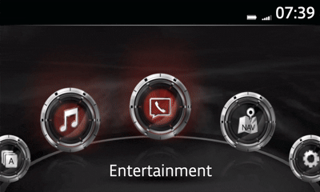

# Android Auto Mod

OEM Android Auto Mod version **0.10.0** for CMU **74.00.324**.

This tweak unlocks touchscreen input while driving in Android Auto and forwards
turn-by-turn navigation guidance, lane recommendations and street names to
the Active Driving Display (HUD).

## Features

- **Touchscreen unlock**: Enables touch input while parked and moving in Android Auto.
- **HUD navigation**: Displays turn directions, lane recommendations, and street names from Android Auto navigation (Google Maps, Waze, Yanosik) on the Active Driving Display (Windshield and Combiner HUD).
- **Speed limit detection**: Keeps speed limits from the factory navigation SD card visible on the HUD while Android Auto navigation is active.
- **Media control**: Pauses music when muting and resumes on unmute in Android Auto.
- **Audio cut-off fix**: Low-latency ALSA audio pipeline and amp mix hold to prevent clipped navigation voice prompts.
- **Configurable resolution and aspect ratio**: Supports factory 7 and 8-inch displays as well as aftermarket 10.25-inch screens.
- **GAL v1.6 support**: Protocol negotiation for modern Android Auto capabilities.

## Settings

### Installer settings

Configurable in the installer UI or via `user/android-auto/settings.conf`:

| Setting | Type | Default | Description |
| --- | --- | --- | --- |
| `resolution_dpi` | Number (100–160) | `141` | Display DPI. Common values impacting layout: 103, 113, 122, 141, 153, 160. |
| `resolution_par` | Choice | `10670` | Pixel aspect ratio. Factory screen: `10670`. Aftermarket 10.25-inch display: `15800`. |

### Applications menu GUI (`libpatch.conf`)

Once installed, an **Android Auto Settings** entry appears under the vehicle **Applications** menu.
The interactive GUI allows managing runtime library settings directly on the CMU without replugging a USB drive:

- **Touchscreen while driving** (`touch`) - enables touchscreen in Android Auto interface as long as touchscreen is unlocked in entire MZD Connect system with a separate tweak.
- **Show navigation on HUD** (`hud`) - forwards turn-by-turn navigation arrows and distance from Android Auto to the head-up display (Active Driving Display). When turned off, navigation information stays on the center display only.
- **Show speed limit with Nav SD** (`hud_transport`: `svcnavi` = ON, `vbs` = OFF) - routes HUD data through the car's built-in navigation service (`svcnavi`) so speed limit signs from the Mazda SD card remain visible alongside Android Auto directions. Turn off (`vbs`) only if your car does not have a factory navigation SD card and turns fail to display.
- **Show street name on HUD** (`force_street_name`) - forces upcoming street names onto the head-up display, even in regions (such as Europe) where factory firmware normally hides the street line. Maneuver arrows and distance countdowns continue to work normally regardless of this setting. Compatible with windshield color HUD only.
- **Fix accented HUD letters** (`hud_fold_latin`) - replaces special accented letters (such as Vietnamese or Eastern European diacritics) with readable base letters on the head-up display. This prevents characters from appearing as blank spaces caused by the car display's limited font support.
- **Detailed HUD turns & lanes** (`use_protocol_v1_6`) - enables the newer Android Auto navigation protocol (GAL 1.6) between your phone and the car. This sends rich navigation data to the head-up display, including lane recommendations, detailed junction maneuvers, and distance countdowns.
- **Show roundabout exit number** (`roundabout_prepend_exit_number`) - displays which roundabout exit to take directly in front of the street name on the head-up display (for example, "(2) Main St") when exit angles are not provided by the navigation app (Waze). Compatible with windshield color HUD only.
- **Show HUD turns within** (`hud_maneuver_max_distance_m`: `500`, `1000`, `1500`, `3000`, `5000`, `7500`, `10000`, `20000`, `0 = Unlimited`) - hides navigation arrows, the distance and the street name from the head-up display during long highway stretches when your next turn is far away, reducing clutter. Directions will reappear automatically once you get within the selected distance (or stay always visible with `0 = Unlimited`). Displays the selected value on the right hand side and opens a dedicated single-choice submenu with checkmarks.
- **Cluster compass always on** (`compass_always_on`) - keeps the digital compass in your instrument cluster working at all times. This fixes the issue where applying a touchscreen-while-driving tweak permanently disables the cluster compass.
- **Allow unknown wireless adapters** (`bt_pairing_bypass_all_devices`) - allows aftermarket wireless Android Auto adapters (dongles) to connect even if their brand or model is not in the built-in recognized devices list. Enable this if your wireless adapter gets stuck while connecting.
- **Show wireless adapter name** (`bt_pairing_show_device_notification`) - displays a temporary pop-up notification at the top of the screen showing the USB device name reported by your connected adapter. Useful for identifying an unrecognized wireless dongle.
- **Pause media when muted** (`mute_pauses_phone`) - automatically pauses music, podcasts, or audiobooks on your phone when you press the car's mute button. Playback resumes automatically when unmuted so you don't miss anything while muted.
- **Force play on unmute** (`unmute_starts_playback`) - sends a play command to Android Auto every time the system is unmuted, even if playback was not paused by the mute button. Leave off if you only want playback to resume when it was previously paused by muting.
- **Prevent car media auto-play** (`block_headunit_media_play`) - stops the car from automatically starting music playback whenever Android Auto connects or when switching audio sources. You can still start music playback manually from the screen, steering wheel, or phone controls.
- **Fix cut-off navigation voice** (`aa_audio_low_latency`) - fixes the issue where spoken navigation directions (such as from Google Maps or Waze) get clipped or cut off at the beginning or end of words. It keeps the car audio channel ready so voice guidance plays smoothly without delays.

Settings are read from and atomically written to `/tmp/mnt/data_persist/oem-aa-mod/libpatch.conf` via the secure local GUI service.

## User settings and configuration overrides

Custom default settings and runtime configuration can be placed on the USB drive:

- `user/android-auto/settings.conf`: Default values for `resolution_dpi` and `resolution_par`.
  These are validated against the manifest schema (numerical bounds and choice options).
- `user/android-auto/libpatch.conf`: Custom runtime library options (e.g. `use_protocol_v1_6`,
  `aa_audio_low_latency`, touch behavior, HUD options).
  - **Full replacement**: The override file replaces `assets/libpatch.conf` entirely; it is
    **not merged** with the bundled default file. Any options omitted from your override will
    not be present in the installed file.
  - **Validation**: `libpatch.conf` is checked against the 64 KB size limit, copied into the
    persistent snapshot, and compared byte-for-byte (`cmp -s`). It is evaluated at runtime
    by the Android Auto mod libraries.
  - **Size limit**: Configuration overrides must not exceed 64 KB (65,536 bytes) and their
    size is included in the persistent storage free-space calculation.

See [User settings](../../../wiki/User-settings.md) for detailed instructions.

## Hardware and vehicle compatibility

### Vehicle models

The Android Auto tweak is compatible with all Mazda vehicles equipped with the **MZD Connect generation 1** infotainment system running **firmware version 74.00.324** (regardless of market region: EU, NA, 4A, etc.), provided the car has the official or aftermarket Apple CarPlay / Android Auto USB hub installed:

- **Mazda 2 / Demio** (DJ / DL, 2014+)
- **Mazda 3 / Axela** (BM / BN, 2013–2018)
- **Mazda 6 / Atenza** (GJ / GL, 2015+ facelift)
- **Mazda CX-3** (DK, 2015+)
- **Mazda CX-5** (KE facelift 2015+, KF 2017+)
- **Mazda CX-8** (KG)
- **Mazda CX-9** (TC, 2016+)
- **Mazda MX-5 / Miata** (ND, 2015+)

> [!NOTE]
> MZD Connect generation 2 systems (Mazda Connect 2 with widescreen center display found on Mazda 3 BP from 2019+, CX-30, CX-50, CX-60, CX-90) use a different hardware platform and architecture, and are not supported.

### Head-Up Display (Active Driving Display) compatibility

- **Windshield Color HUD (`WHUD_color`)**: Fully supported. Displays maneuver turn arrows, distance countdowns, lane guidance, upcoming street names, and speed limits (with factory navigation SD card inserted).
- **Combiner HUD (`CHUD_color` / `CHUD_mono`)**: Supported for turn-by-turn maneuver arrows and distance countdowns.
  - *Street names*: Combiner flip-up glass displays (found in early Mazda 3 BM, Mazda 2, CX-3) lack native hardware and firmware support for rendering street name text strings.
  - *Speed limits on mono combiner HUD (`CHUD_mono`)*: The early monochrome/blue combiner HUD does not support showing SD card speed limits alongside Android Auto navigation.
- **Vehicles without HUD**: Touchscreen unlock, audio fixes, and all other Android Auto features work normally. Navigation arrows are simply not displayed on a HUD.

### Firmware version requirement

- **Officially targeted firmware**: **v74.00.324** (EU, NA, 4A).
- Older firmware versions (such as v59, v70.00.3xx, or older v74 builds like 74.00.310 / 74.00.311) are not supported by the ready-to-run installer. Users must update to **v74.00.324** before installing this tweak to avoid library incompatibility or system instability.

## Issues

### Disappearing or missing street names on the HUD

In certain markets and firmware versions (especially European vehicles), the factory navigation service blanks or suppresses the street name line on the head-up display between maneuvers, or prevents street names from showing at all. Furthermore, cars imported from North America into Europe with language changed may have street info disabled in hidden menus.

**Solutions:**

- **Force street names in Android Auto**: Turn on **Show street name on HUD** (`force_street_name = true`) in the in-car Android Auto Applications menu. This forces the upcoming street name onto the HUD display strip even when the car's native navigation service attempts to blank it.
- **Change CMU language to English**: Some languages (for example Hungarian) do not have full font/character rendering support for HUD street lines in factory firmware. Setting the MZD Connect language to English ensures full text compatibility.
- **Unlock native vehicle settings with [HUD Street Name](../hud-street-name/README.md)**: Install the **HUD Street Name** (`hud-street-name`) tweak. On vehicles with a color windshield HUD (`WHUD_color`), this unlocks the hidden factory menu under **Settings > Active Driving Display > Display Information > Street Information** (normally restricted to North America). It gives you native control to choose whether street information appears **Always**, **At Maneuver**, or **Off**.
- **Fix special accented characters**: Turn on **Fix accented HUD letters** (`hud_fold_latin = true`) if accented letters (e.g. Eastern European or Vietnamese diacritics) appear as blank spaces or cause missing text due to limited font glyphs on the HUD.

### Wrong roundabout exit arrow with Waze

When navigating with Waze, Waze only transmits the roundabout exit number without an exact exit angle over Android Auto protocol. Consequently, the HUD displays a best-guess roundabout maneuver arrow based on the exit number.

**Solution:**

- Turn on **Show roundabout exit number** (`roundabout_prepend_exit_number = true`) in the Android Auto Applications menu. This prepends the exit number directly in front of the street name (e.g. `(2) Main St`) so the correct exit is clearly visible on the color windshield HUD.

### Stretched image on aftermarket 10.25-inch displays

When installing an aftermarket 10.25-inch screen (1920x720) in place of the factory display, the stock CMU output (800x480) appears stretched horizontally because the default Pixel Aspect Ratio (PAR) is calibrated for the factory 16:9 ratio.

**Solution:**

- Set `resolution_par` to `15800` (factory default is `10670`) in `user/android-auto/settings.conf` or select it in the installer UI. This corrects the aspect ratio so Android Auto renders with sharp, undistorted proportions.

### UI elements too small or crowded in divided screen mode

A very low DPI (such as `103`) can either hide turn details in divided screen mode or make touch targets too small to press easily while driving.

**Solutions:**

- Adjust `resolution_dpi` in `user/android-auto/settings.conf` (or via wireless adapter companion apps like AAWireless). A value of `122` provides an optimal balance where turn details remain visible on split screen while touch targets remain easy to tap.
- On 10.25-inch aftermarket displays set DPI `153` when Pixel Aspect Ratio was corrected.

### Wireless Android Auto adapters and AI boxes (Carlinkit, P3.2, AAWireless)

Certain aftermarket wireless adapters, dongles, or standalone AI boxes may fail to pair, fail to display navigation on the HUD, or emulate an incompatible projection protocol.

**Solutions:**

- **Dongles using native Android Auto protocol (AAWireless, Carlinkit AA)**: Turn on **Allow unknown wireless adapters** (`bt_pairing_bypass_all_devices = true`) in the Android Auto Applications menu if pairing stalls or navigation fails to display wirelessly.
- **Standalone Android boxes (e.g., P3.2, Carlinkit TBox)**: Ensure the box connects using the native Android Auto protocol (an Android Auto icon appears in the top-left corner of the Mazda home screen). If the device emulates Apple CarPlay (showing a CarPlay icon on the CMU), Android Auto mods will not apply.
- **Apple CarPlay users**: Note that this tweak modifies Android Auto binaries only. Apple CarPlay turn-by-turn navigation on the HUD requires a separate CarPlay-specific modification.

### Coexistence with legacy AIO Tweaks

Installing this tweak on a system that already has legacy MZD-AIO tweaks installed can cause confusion over overlapping features, or using outdated AIO installers may cause system instability.

**Solutions:**

- If touchscreen while driving was already unlocked via AIO, you do not need to reapply speed restriction toggles.
- Do not use old AIO installer scripts to install or overwrite Android Auto files on v74. Legacy AIO scripts are not designed for firmware v74 and may cause bootloops or break wireless connectivity.

### Spurious "Enable Android Auto" prompt upon vehicle startup

Occasionally when starting the vehicle, Android Auto connects (audio may even start playing in the background), but an **Enable Android Auto** prompt appears on the center display instructing you to unlock your phone and allow the connection, with only a **Cancel** button available.

**Solutions:**

- **GAL protocol bypass timing**: The protocol negotiation under GAL 1.6 bypasses the stock screen prompt, which on some phones (e.g. Google Pixel) or wireless dongles may trigger a race condition upon CMU boot. In the Android Auto Applications menu, set **Detailed HUD turns & lanes** to OFF (`use_protocol_v1_6 = false`) to revert to the factory GAL 1.5 protocol.
- **Audio pipeline latency**: In the Android Auto Applications menu, try turning off **Fix cut-off navigation voice** (`aa_audio_low_latency = false`).
- **Bluetooth profile conflict**: Unpair and remove the phone from the car's native MZD Connect Bluetooth device list, allowing Android Auto / your wireless adapter to manage the projection and audio session exclusively.
- **Wireless adapter companion settings**: If using an AAWireless dongle, open the AAWireless companion app and enable **Auto Video Focus** under Advanced Settings to force Android Auto into the foreground upon connection.
- **Conflict with legacy AIO Tweaks**: If old AIO tweaks like *No More Disclaimer* or *Order of Audio Sources* were previously applied, uninstall them as they overwrite system files that disrupt Android Auto and wireless projection handshakes.

### Receiving or making a phone call kicks out to Mazda native UI or freezes AA

When receiving or making a phone call while using Android Auto, the screen drops back to the stock Mazda MZD Connect communication screen, and holding the Home button may fail to return to Android Auto or causes Android Auto to freeze completely until the adapter is unplugged.

**Solutions:**

- **Media and mute state synchronization**: Revert media management options in the Android Auto Applications menu to factory defaults:
  - Turn off **Pause media when muted** (`mute_pauses_phone = false`)
  - Turn off **Force play on unmute** (`unmute_starts_playback = false`)
  - Turn off **Prevent car media auto-play** (`block_headunit_media_play = false`)
- **Native Bluetooth call routing conflict**: When the phone is paired to both MZD Connect Bluetooth and a wireless Android Auto adapter, the car's native hands-free system competes for call state. Unpair the phone from MZD Connect Bluetooth so all telephony is routed cleanly through Android Auto.
- **Protocol fallback**: Set **Detailed HUD turns & lanes** to OFF (`use_protocol_v1_6 = false`) and **Fix cut-off navigation voice** to OFF (`aa_audio_low_latency = false`) to match factory audio/telephony timing.
- **Wireless adapter frequency interference**: In the wireless adapter's settings, change the Wi-Fi band between 2.4 GHz and 5 GHz, or test with a direct USB cable connection to isolate adapter drops.

### Pausing music after phone calls

Music remains paused or behaves inconsistently after ending a voice call.

**Solution:**

- Turn off **Pause media when muted** (`mute_pauses_phone = false`) in the Android Auto Applications menu to restore stock audio behavior.

### Touchscreen works only when parked

Touchscreen input in Android Auto remains locked or disabled while the vehicle is in motion.

**Solution:**

- Touchscreen input in Android Auto is controlled by the system-wide MZD Connect speed restriction. Install the [Touchscreen While Driving](../touch-while-driving/README.md) tweak to unlock touch input while moving.

### Need to restart

Changes do not appear or the CMU requires a reboot to restore normal operation.

**Solution:**

- Hold down **NAV + MUTE** for a few seconds to reboot the CMU, then wait 30–120 seconds for the system to restart.

### Getting help and reporting new issues

If you encounter a bug or an issue not covered above:

- **Report new issues and bug reports**: Open an issue on the upstream GitHub repository at [VitaliyKurokhtin/oem-aa-mod/issues](https://github.com/VitaliyKurokhtin/oem-aa-mod/issues).
- **Community assistance and troubleshooting**: Ask for help and share experiences in the Mazda3Revolution forum thread: [v74 OEM Android Auto Mod (Multi-touch, HUD, SD-card speed limit)](https://www.mazda3revolution.com/threads/v74-oem-android-auto-mod-multi-touch-hud-sd-card-speed-limit.257358/).

## Installed files

- **Payload directory**: `/tmp/mnt/data_persist/oem-aa-mod/`
  - `libpatch-blmjciaapa.so` (preloaded into `jciAAPA`)
  - `libpatch-svcjcinavi.so` (preloaded into `jcinavi`)
  - `libpatch-aap_service.so` (preloaded into `aap_service`)
  - `libpatch.conf` (runtime configuration)
- **Service configurations**: `/jci/sm/sm.conf` and `/jci/sm/sm_WCP.conf`
- **System attributes**: `/etc/aap_system_attributes.xml` and `/etc/aap_system_attributes_UCP.xml`
